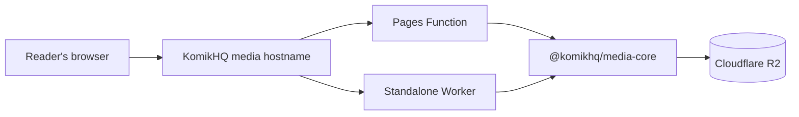

<div align="center">
  <picture>
    <source media="(prefers-color-scheme: dark)" srcset="https://raw.githubusercontent.com/komikhq/media/main/apps/pages/public/logo-wordmark-dark.svg">
    <source media="(prefers-color-scheme: light)" srcset="https://raw.githubusercontent.com/komikhq/media/main/apps/pages/public/logo-wordmark-light.svg">
    
  </picture>
  <h3>Every panel, delivered.</h3>
  <p>A shared, read-only media layer for the KomikHQ universe.</p>
  <p>
    <a href="https://github.com/komikhq/media">
      
    </a>
    <a href="https://pages.cloudflare.com/">
      
    </a>
    <a href="https://workers.cloudflare.com/">
      
    </a>
    <a href="https://www.cloudflare.com/developer-platform/products/r2/">
      
    </a>
  </p>
</div>

---

KomikHQ Media serves images and other static media stored in Cloudflare R2 through a KomikHQ-controlled hostname. One shared package keeps object lookup, response metadata, and cache policy consistent across two independently deployable runtimes.

> **Built for the edge. Shared by design.**

## At a glance

| | |
| --- | --- |
| **Delivery targets** | Cloudflare Pages Functions and a standalone Cloudflare Worker |
| **Object storage** | Cloudflare R2, bound as `MEDIA_BUCKET` |
| **Shared logic** | `@komikhq/media-core` |
| **Access model** | Read-only media delivery |
| **Workspace** | pnpm |

## How a request travels



Choose either runtime—or deploy both. They use the same request handling and R2 binding contract; the Pages project and Worker remain separate deployments.

## What it does

<table>
  <tr>
    <td width="50%">
      <h3>🧭 Predictable paths</h3>
      Request paths map to slash-separated R2 object keys. The root path resolves to <code>index.html</code>; query strings don't change the key.
    </td>
    <td width="50%">
      <h3>🧩 One shared core</h3>
      Validation, object access, HTTP metadata, error handling, and cache policy live in <code>packages/media-core</code>.
    </td>
  </tr>
  <tr>
    <td width="50%">
      <h3>📦 Streamed responses</h3>
      Object bodies are served as streams, with available R2 metadata carried into the response.
    </td>
    <td width="50%">
      <h3>🌗 Thoughtful errors</h3>
      Browser requests that accept HTML get a responsive, branded error page; other clients receive JSON. Errors are not cached as successful media.
    </td>
  </tr>
</table>

The error page includes Lucide icons, follows the visitor's light/dark preference, and shows the Cloudflare Ray ID when available. It handles application-level delivery errors; Cloudflare edge or platform errors that occur before the app runs need separate Cloudflare error-page configuration.

## Workspace map

```text
apps/
├── cors-generator/    React + Vite app for building CORS policies
├── pages/             Cloudflare Pages Functions and public brand assets
└── worker/            Standalone Worker, static assets, and deploy tooling
packages/
├── media-core/        Shared R2 request and response behavior
└── ui/                Shared shadcn components, Radix-based preset, and styles
```

The CORS generator is a static Vite app deployed to GitHub Pages by
[`.github/workflows/deploy-cors-generator.yml`](./.github/workflows/deploy-cors-generator.yml).
Its UI primitives live in `packages/ui` so the Pages and Worker error surfaces
can reuse them. Add shared shadcn primitives with
`pnpm shadcn add card --cwd packages/ui`, then import them from
`@komikhq/ui/components/*`. Run the generator locally with
`pnpm dev:cors-generator`; press **D** to toggle the template's light/dark
appearance.

## Get started

Use the workspace's pinned pnpm version (`12.10.1`):

```sh
pnpm install
```

Start either target locally. Wrangler uses a local R2 simulation, so routine development does not need production credentials:

```sh
pnpm dev:pages
pnpm dev:worker
```

To run the standalone Worker with its preview configuration:

```sh
pnpm dev:worker:preview
```

## Check your changes

Run the workspace checks before opening a pull request:

```sh
pnpm typecheck
pnpm test
pnpm build
```

## Deploy

Pages and the standalone Worker are separate deployment targets, each with its own configuration, project settings, bindings, and lifecycle.

| Target | Local development | Production | Preview |
| --- | --- | --- | --- |
| **Pages** | `pnpm dev:pages` | `pnpm deploy:pages` | `pnpm deploy:pages:preview` |
| **Worker** | `pnpm dev:worker` | `pnpm deploy:worker` | `pnpm deploy:worker:preview` |

The CORS generator deploys separately through GitHub Actions. Enable GitHub Pages
for the repository with **GitHub Actions** as its build and deployment source.
The workflow sets the Vite base path to the repository name for project Pages URLs.

Public media should use a KomikHQ-controlled custom hostname. Do not expose an R2 `r2.dev` URL or an R2 custom-domain endpoint as the public delivery URL.

### Caching, clearly

Successful object responses include `Cache-Control: public, max-age=3600, s-maxage=86400, stale-while-revalidate=604800`. Error responses use `no-store`.

Those headers define response cache policy; they do **not** mean every deployment path is automatically cached by the CDN. Workers Cache and Pages caching are configured and verified separately. When replacing an object at the same key, invalidate the relevant cache; for immutable releases, prefer versioned object paths.

For project setup, bindings, local R2 behavior, custom hostnames, and deployment details, see the **[deployment guide](./DEPLOYMENT.md)**.

---

<div align="center">
  <sub>Media delivery for KomikHQ — made to keep the story moving.</sub>
</div>
